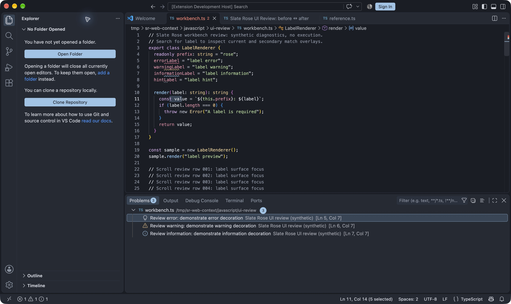

# Slate Rose

Slate Rose is a dark theme for the VS Code editor, workbench, and integrated
terminal. It uses sand for types, blue for functions, rose for fields, lilac
for declarations, coral for flow control, and green for strings.



## Installation

1. Install **Slate Rose** from the [VS Code Marketplace](https://marketplace.visualstudio.com/items?itemName=skr0ls.slate-rose).
   For manual installation, download `slate-rose.vsix` from
   [GitHub Releases](https://github.com/Skr0ls/slate-rose/releases) and run
   **Extensions: Install from VSIX...** in the Command Palette.
2. Run **Preferences: Color Theme** and select **Slate Rose**.

## Coverage

The package targets VS Code 1.143 and newer. Documented reviews cover 1.143.1
and 1.146.0 on macOS. Language providers can assign different token categories.
For example, C# semantic keyword tokens can override the lexical primitive
and flow colors.

The theme covers editor and workbench states, including modern window framing
where VS Code supports it. The integrated terminal uses a separate ANSI
palette. Native terminal acceptance is still open, and VS Code's contrast
and bold settings can affect the rendered colors.

[Review evidence](https://github.com/Skr0ls/slate-rose/blob/main/previews/README.md) ·
[Report an issue](https://github.com/Skr0ls/slate-rose/issues)

## Build from source

Use Node.js 22 or newer and Python 3.11 or newer. Run these commands
from the repository root.

```sh
python -m generators check vscode
mkdir -p dist
(cd packages/vscode && SOURCE_DATE_EPOCH=1794787200 TZ=UTC npx --yes @vscode/vsce@4.1.1 package --no-dependencies --out ../../dist/slate-rose.vsix)
python scripts/check_vsix.py dist/slate-rose.vsix
```

Licensed under the MIT License; see the included LICENSE notice.
